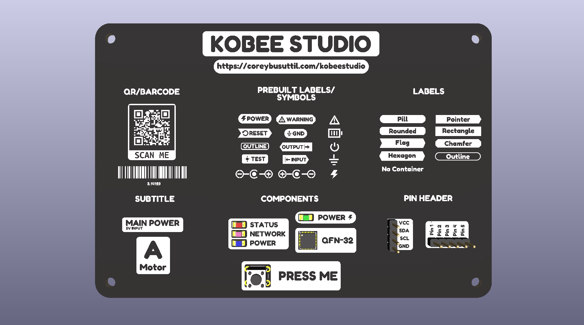
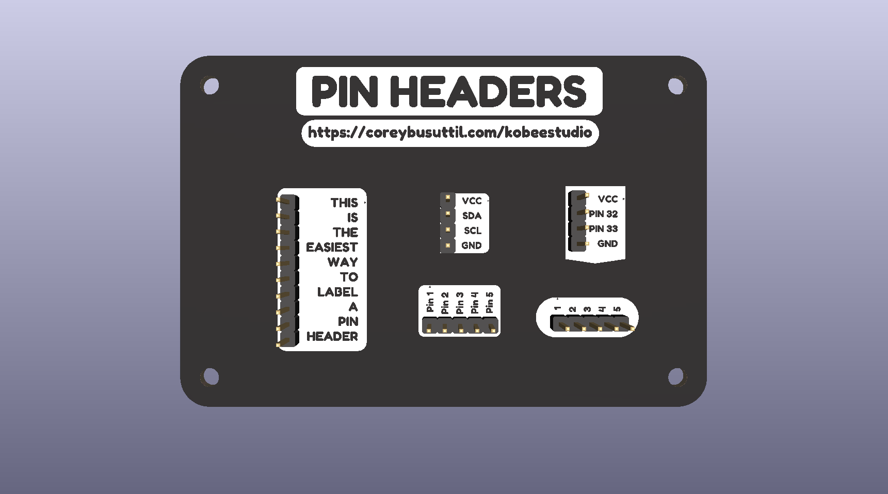
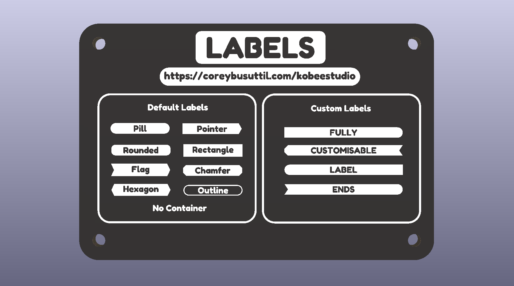
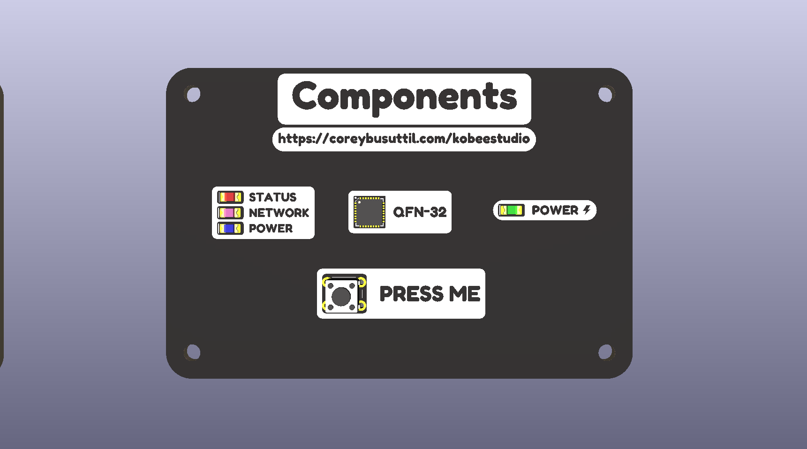
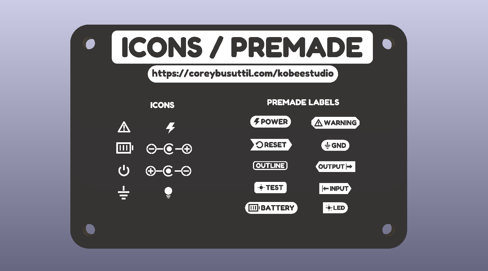
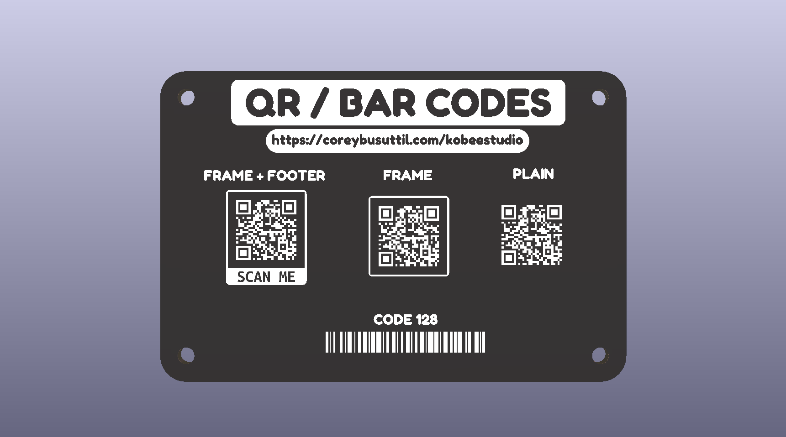

<h1 align="center">Kobee Studio</h1>

<div align="center"></div>

<h2 align="center">Modern PCB graphics for KiCad</h2>

<p align="center">
  Design beautiful labels, icons, connector overlays and PCB artwork without leaving KiCad.
</p>

<p align="center">
  <a href="#install-kobee-studio--kicad-10"><strong>↓ Skip to install instructions</strong></a>
</p>

> **Current stable release · 1.5.20 for KiCad 10.** Install the ZIP from [GitHub Releases](https://github.com/mrcpuddington/kobeestudio/releases/tag/v1.5.20) using **Plugin and Content Manager → Install from File**.
>
> KiCad's official catalog lists **1.4.1** while the 1.5.20 update goes through KiCad's review and catalog refresh.

## Quick install — official KiCad repository

1. From KiCad's main Project Manager window, open **Plugin and Content Manager**.
2. Select **KiCad official repository**, choose **Refresh**, and search for **Kobee Studio**.
3. Select the offered compatible version, choose **Install**, then **Apply Pending Changes**.
4. Open a saved board in PCB Editor and launch **Tools → External Plugins → Kobee Studio: Create PCB Artwork**.

If the default repository was removed, use **Manage… → + menu → Add Default Repository**. Use **Install from File** to install 1.5.20 while the catalog update is pending.

The [complete install guide](https://kobee.com.au/tutorials/kobee-studio-install) also covers optional custom stable/testing catalogues, release ZIPs, updates and troubleshooting.

If you want the backstory, I wrote a short post about outgrowing KiBuzzard and
starting Kobee Studio: [I outgrew KiBuzzard, so I built a KiCad PCB graphics plugin](https://kobee.com.au/news/i-outgrew-kibuzzard-kobee-studio).

<p align="center">
  
</p>

The repository includes the [editable KiCad showcase board](examples/showcase/)
used for this render, with labels, symbols, component callouts, component
arrays, connector overlays, machine-readable codes and multilayer artwork.

---

## Why?

I’m building Kobee Studio because I like making boards and want their labels, symbols and small visual details to be easier to make and revise.

It started as a fork of **[KiBuzzard](https://github.com/gregdavill/KiBuzzard)** by Greg Davill. That text-to-label workflow was a useful starting point; I kept building around connector legends, component callouts, machine-readable marks and reusable artwork. KiBuzzard deserves the credit for the foundation.

If you found this while looking for a KiBuzzard alternative, the [practical comparison](https://kobee.com.au/tutorials/kobee-studio-kibuzzard-comparison) explains the shared roots, differences and migration checks. A simple label workflow may already be enough for your boards.

## What’s new in 1.5.20

- System-font activation and searchable Google Fonts, face previews, offline reuse and missing-font repair.
- Reusable SVG graphics, PNG tracing, transforms and personal/project libraries.
- More connector pitches, component presets and nine placement anchors.
- Independent underline/overline controls and optional subscript/superscript text formatting.
- Project-variable templates, Project Data fields and revision checkpoints with explicit KiCad synchronization.
- Styled designators and scoped board cleanup tools, with selection and undo checks.
- Preview, geometry, placement and dialog-lifecycle hardening.

See the [release notes](docs/releases/1.5.20-notes.md) for compatibility and validation details and the [illustrated manual](https://kobee.com.au/tutorials/kobee-studio-docs) for workflows.

## Core artwork tools

| Capability                    | What it does                                                                                           |
| ----------------------------- | ------------------------------------------------------------------------------------------------------ |
| Parametric labels             | Filled, inverted and outline labels with flexible shapes, padding, borders, mixed ends and underlines. |
| Icons and quick labels        | Searchable PCB-safe symbols and reusable labels, usable standalone, beside text or inside a label.     |
| Custom SVG uploads            | Add your own icons and symbol variants, with project-only or personal library scope.                   |
| Library visibility            | Hide or show bundled symbols and quick labels so the picker stays focused on your workflow.            |
| Saved profiles                | Save, recall, delete and set defaults for tool settings across future artwork sessions.                |
| Millimetres and mils          | Switch measurement display units while keeping artwork geometry consistent internally.                 |
| Header overlays               | Pin labels for single-row 2.54 mm headers, with clearances, openings and editable layout.              |
| Component callouts and arrays | Frame packages, switches and LED arrays, or repeat callouts in editable rows and columns.              |
| QR codes and barcodes         | Generate fabrication-minded QR and Code 128 artwork with optional readable text.                       |
| Layer control                 | Generate artwork on front/back silkscreen, copper and solder-mask layers.                              |

Artwork tools generate ordinary, editable KiCad footprints separate from electrical components. Board Tools can alter native reference visibility or silkscreen. Review their scope before applying them.

Need a hand? The [complete manual](https://kobee.com.au/tutorials/kobee-studio-docs) covers installation, artwork tools, settings and troubleshooting. The released app’s **Need help?** button also opens its documentation hub.

## Features

Kobee Studio keeps the workflow inside PCB Editor while producing ordinary,
editable KiCad footprints.

### Output layers

Generate artwork on:

- Front Silkscreen, Bottom Silkscreen, Front Copper, Bottom Copper, Front Solder Mask, Bottom Solder Mask

## Header Overlays



Generate configurable connector overlays in seconds.

Connector Overlay supports single-row connectors with standard and custom pitches.

Features: Automatic pin labels, Configurable plug clearance, optional openings

---

## Parametric Labels



Generate labels with configurable containers. Supported shapes include:

- Rounded rectangles, Pills, Flags, Tabs, Pointers, Chamfers, Hexagons

Every label supports:

- Fill, Outline, Border width, Padding, Corner radius, Independent end styles and an optional underline
- Quick insertion of useful special characters, including forward slash and backslash

Generated artwork remains fully editable inside KiCad.

---

## Component callouts



Component callouts create a clear label around a real component without changing its electrical footprint. Start with a common passive, LED or tactile-switch envelope, or enter custom dimensions when the package is unusual. Kobee Studio keeps a configurable safe zone around the part, then places the label and optional symbol on the chosen side.

For repeated parts, **Component Array** extends the same idea into a vertical stack or horizontal row, with editable pitch and one label per component. It is useful for LED banks, status indicators and other repeated board features that need to stay easy to identify.

---

## PCB Icons



Kobee Studio includes a growing collection of PCB-safe icons, plus a custom SVG
library for icons and symbol variants that are specific to your own boards.

Current icons include:

- Ground, Power, LED, Battery, Warning, Input, Output, Test Point, Polarity

* Many More

Icons can be used standalone, beside text or inside labels. Use **Settings →
Uploads** to add custom SVG assets, and **Settings → Bundled visibility** to
hide or restore shipped symbols and quick labels.

---

## QR Codes and Barcodes


Generate machine-readable PCB artwork directly from a payload.

- QR Codes use automatic error-correction sizing and a protected four-module quiet zone.
- QR presentation can be plain, placed in a rounded frame, or use a rounded frame with an optional negative footer such as **SCAN ME**. Extra frame spacing is adjustable down to zero without reducing the protected quiet zone.
- Code 128 uses compact 0.25 mm modules and 4.0 mm bars by default, with guarded minimums of 0.20 mm and 3.0 mm.
- QR codes and barcodes can show a separate editable line of human-readable text below the generated code. The printed text does not change the encoded payload.

Small codes should always be checked against the chosen PCB finish, fabricator capabilities and the scanner that will be used.

---

## Roadmap

Kobee Studio is growing beyond labels into a complete PCB graphics toolkit.

I've started to create a more robust **[Roadmap](https://github.com/mrcpuddington/kobeestudio/blob/main/ROADMAP.md)**, which will be updated as the project evolves.

## Install Kobee Studio — KiCad 10

Kobee Studio is a KiCad plugin, not a footprint library.

### Preferred: KiCad's official plugin repository

Kobee Studio is included in the official catalogue. From KiCad's main window, open **Plugin and Content Manager**, select **KiCad official repository**, refresh, find **Kobee Studio**, choose the offered version and **Install**, then **Apply Pending Changes**.

The official version table lists each package's compatibility and channel. Use the GitHub ZIP below for 1.5.20 while KiCad reviews the catalog update.

### Alternative: custom stable catalogue

If you want to use the Kobee-maintained stable stream, add this optional URL through **Manage repositories → Add**, save and refresh:

```text
https://raw.githubusercontent.com/mrcpuddington/mrcpuddington-kicad-repository/main/repository.json
```

Choose the intended version, then install/update and apply pending changes. Avoid duplicate old manual installations or obsolete catalogue URLs that make it unclear which copy KiCad is loading.

### Alternative: custom testing catalogue

For deliberately selected testing builds, use:

```text
https://raw.githubusercontent.com/mrcpuddington/mrcpuddington-kicad-repository/testing/repository.json
```

Check the version and release notes actually offered. This is a rolling stream and is separate from the official repository; adding it does not create a package that has not been published yet.

### Other option: install the ZIP manually

Download the [Kobee Studio 1.5.20 PCM ZIP](https://github.com/mrcpuddington/kobeestudio/releases/download/v1.5.20/Kobee-Studio-1.5.20-pcm.zip)
and select the ZIP directly in KiCad.

1. Open KiCad's **Plugin and Content Manager** and choose **Install from File…**.
2. Select the downloaded ZIP and approve the install.
3. Apply pending changes if shown, then open a board in PCB Editor and choose **Tools → External Plugins → Kobee Studio: Create PCB Artwork**. The Kobee Studio toolbar button can also be enabled from PCB Editor's **Preferences/Settings → Action Plugins** page.

If the toolbar button does not appear:

1. Fully quit PCB Editor and open it again.
2. Open PCB Editor's **Preferences/Settings → Action Plugins** page and make sure **Show Button** is enabled for **Create PCB Artwork**.
3. Use **Refresh Plugins**, then restart PCB Editor.

More installation help is available in the [Kobee Studio docs](https://kobee.com.au/tutorials/kobee-studio-docs).

### Testing releases

Kobee Studio testing releases are built and published by the release workflow.
When published, install them from the testing PCM repository or the matching attached release asset;
there is no local package-build step for testers.

### Platform support

| Platform | KiCad version | Status                                           |
| -------- | ------------- | ------------------------------------------------ |
| macOS    | KiCad 10      | 1.5.20 tested in PCB Editor on KiCad 10.0.5       |
| Windows  | KiCad 10      | 1.4.1 tested in PCB Editor, 1.5.20 visual checks pending |
| Linux    | KiCad 10      | 1.5.20 CI passed, PCB Editor visual checks pending |

---

## Help and contributing

For installation help, tutorials and practical Kobee Studio guides, visit the [Kobee Studio docs](https://kobee.com.au/tutorials/kobee-studio-docs).

Bug reports, ideas and pull requests are always welcome through GitHub. If you build something cool with Kobee Studio, I'd genuinely love to see it.

## Contributors

- **[Lucas Pfennig (@mrred2k)](https://github.com/mrred2k)** diagnosed why artwork
  updates were rejected on Windows with KiCad 10.0.6, contributed the fix that
  informed the replacement check, and verified that one Undo restored the
  original artwork. [PR #36](https://github.com/mrcpuddington/kobeestudio/pull/36)

---

## Acknowledgements

Kobee Studio builds upon the work of some fantastic open-source projects.

Special thanks to:

- **Greg Davill** for creating **[KiBuzzard](https://github.com/gregdavill/KiBuzzard)**.
- **SparkFun** for the original **Buzzard** project.
- The **Interactive HTML BOM** contributors.
- The **FontTools** contributors.
- The **svg2mod** contributors.

Without their work, Kobee Studio wouldn't exist.

---

## License

Kobee Studio is distributed under GPL-2.0-only (GNU GPL version 2 only), a GPL-compatible open-source licence suitable for KiCad Python-plugin distribution. It incorporates MIT-licensed KiBuzzard material and retains Greg Davill’s original copyright and MIT permission notice alongside all other third-party notices.

See [LICENCE](LICENCE) and [THIRD_PARTY_NOTICES.md](THIRD_PARTY_NOTICES.md) for the complete notices.
