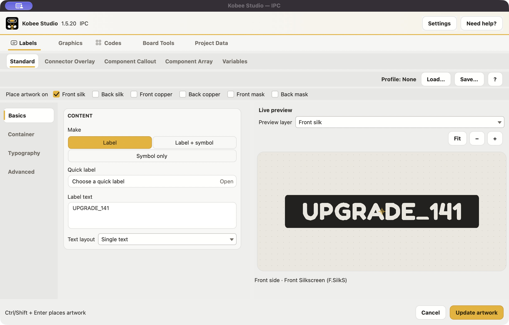
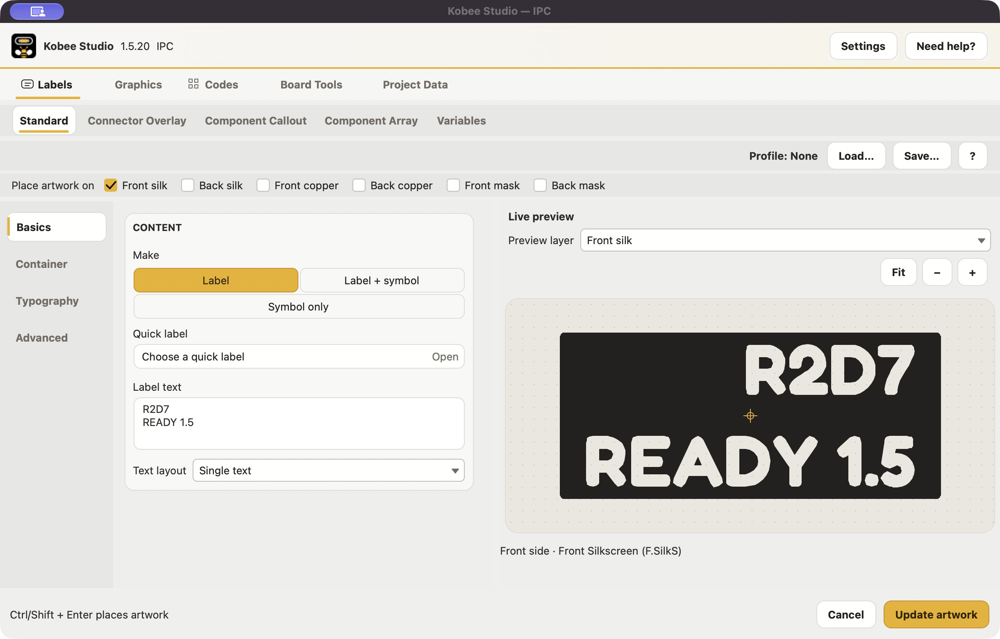
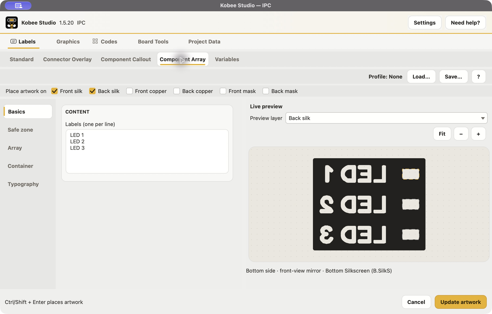
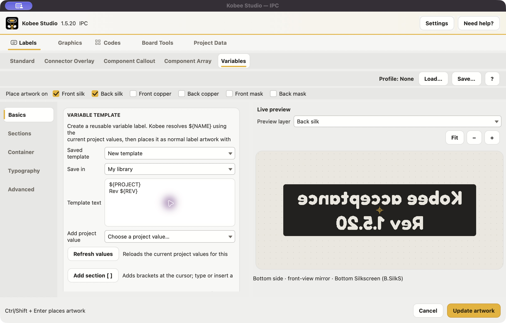
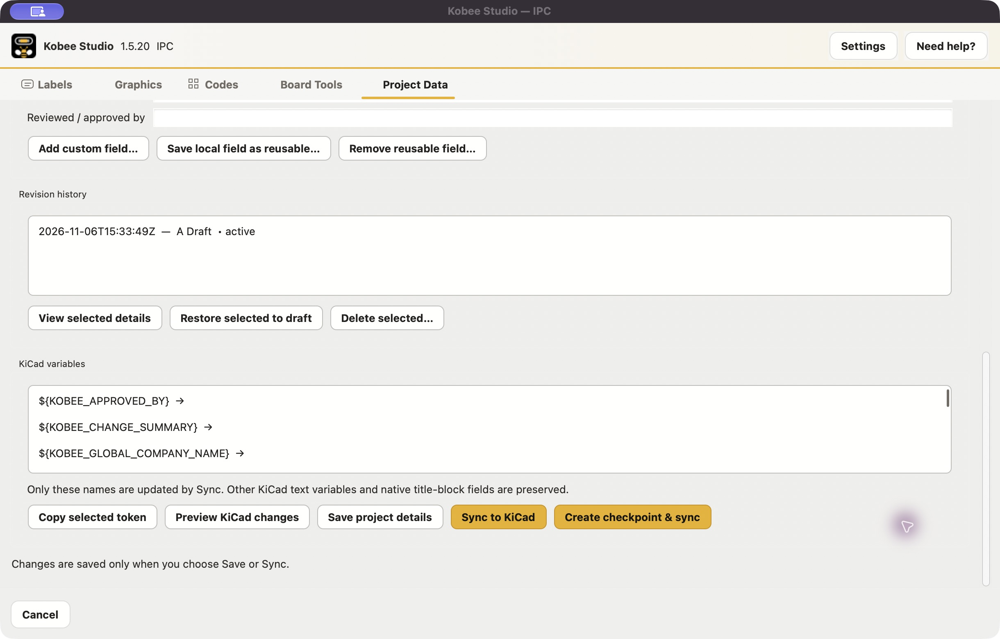
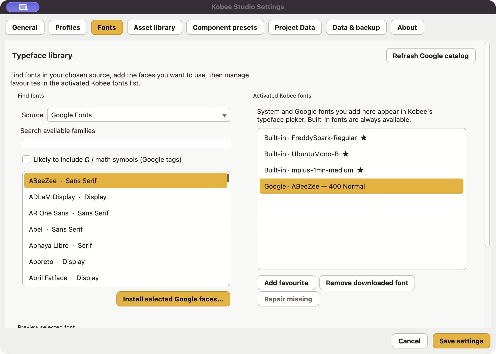

# Kobee Studio 1.5.20 acceptance, 6 November 2026

**Local acceptance passed within the coverage below. Full release approval remains pending.**

Tested the current, uncommitted `DEV` checkout based on `add2c93`, on macOS
27.2 with KiCad 10.0.5 and its Python 3.9/wx runtime. Existing development
changes were preserved. This report does not approve or publish a stable release.

## Latest follow-up: recovery, public upgrade and catalogue diagnostics

The final native suite passes **313 tests**, zero skips/failures, in 19.353 seconds.
The earlier 311-test and 60-case IPC evidence is retained below. Since that suite,
only `kobeestudio/core/data_health.py` changed in the runtime.

A further defect was reproduced in the real source editor: Data Health classified
the valid 2,694,670-byte, 1,959-family Google Fonts catalogue as unsafe under its
ordinary 1 MiB record limit. The scanner now uses the font downloader's existing
16 MiB bound for exactly `fonts/v1/catalog.json`; other records retain 1 MiB.
Two regression tests failed before the correction and pass afterward. The rebuilt
PCM-installed app's Data Health page now reports no malformed or untrusted data.

Hands-on recovery used the real source editor with a disposable data root and a
copy of the existing nine-file backup. Incorrect reset confirmation preserved every
file. Confirmed reset removed custom data and restarted the editor; a valid restore
returned all nine files byte-for-byte. The unsaved `RECOVERY_DRAFT` label survived
both restarts. A backup containing `../escape.txt` was rejected without extraction
or data changes. SVG script import was rejected, and a corrupt PNG showed an error,
kept OK disabled and allowed cancellation back to Settings. Final fixture hashes
still match the starting nine files. This isolated editor did not perform IPC
placement; the installed app's reset/restore cancellation guards were checked
separately. The normal user library was not reset or replaced.

The actual **public 1.4.1 → local testing 1.5.20** update also passed through PCM's
Install from File. The downloaded 1.4.1 ZIP matches official metadata. It was
installed, launched and used to create `UPGRADE_141` on the saved disposable board.
After the 1.5.20 update and a PCB Editor restart, a fresh Kobee session reopened that
artwork and changed it to `UPGRADE_1520`. KiCad's native parser confirms the same
footprint UUID, position and count after save/reload. An already-open app/editor
session initially retained older code; close Kobee Studio and restart PCB Editor
after updating, then check the version in the app header. This verifies local PCM
installation and compatibility, not catalogue delivery of 1.5.20.

The updated ZIP matches all 441 packaged source/support/image files, including
430 runtime files. The retained official validator passes again using that local
archive as an explicit download substitute. No public 1.5 artifact is claimed.

Evidence: [manual recovery and import results](evidence/2026-11-06/manual-recovery.json),
[313-test suite](evidence/2026-11-06/native-tests-recovery.log),
[public-version upgrade and native reload](evidence/2026-11-06/public-upgrade-result.json),
[final package audit](evidence/2026-11-06/package-audit-recovery.json), and
[official local validator](evidence/2026-11-06/official-local-validation-recovery.json).



## Defects found and corrected

1. **Multiline alignment:** unequal-length lines stayed left-aligned when Center
   or Right was selected. The renderer now aligns each line, including inline
   formatting, within the full text block. Geometry regression checks cover
   left/center/right plain and formatted text. The right-aligned result was
   verified in the actual app after reopening saved artwork.
2. **Graphic sizing:** typing width with aspect lock enabled reset it to its old
   value. The child text editor's native event was incorrectly treated as a
   height edit. Both the child and relayed control events now identify the
   correct axis. A native-control test reproduced 10 mm reverting to 20 mm;
   after the fix it retains 10 × 6 mm, then a height edit retains 15 × 9 mm.
   The installed PCM app passed the same edits by hand, plus all four resize handles, rotation and body dragging.
3. **Project Data readability:** rebuilding the page restored native macOS text
   colours and left white text on a pale page. Native history and variable lists
   also rendered blank. Reapply the page theme after every rebuild and use the
   existing themed list control. Contrast checks cover light/dark native fields;
   the installed app now visibly shows its saved checkpoint and variables.
4. **Painted button callbacks:** Project Data, Fonts and component-preset actions
   expected an event argument, although painted buttons invoke callbacks without
   one. Corrected those handlers, checked every Settings button connection, and
   added real button/help/clipboard/checkpoint workflow regressions. Installed-app
   retests passed Project Data help, checkpoint details, copying a token, font
   installation/favourite toggling and opening the component preset editor.
5. **Font repair preview:** a successful redownload retained the old missing-face
   snapshot in the preview. Refresh the matching preview after repair and preserve
   a different font selection if the user changes it during the download. Two
   native regression checks and a rebuilt, PCM-installed app retest pass.
6. **About:** removed the unconditional “Stable release” label. The local PCM
   archive is still a testing candidate.
7. **Catalogue diagnostics:** valid refreshed Google Fonts catalogues no longer
   trigger the generic 1 MiB data-record warning. Only the exact catalogue cache
   uses the downloader's 16 MiB limit; other JSON records retain their limit.

The smoke-test command also now resolves repository imports when run directly.
The expanded live test is retained in `tools/ipc_acceptance_test.py`.



## Fresh verification

| Check | Result and limits |
| --- | --- |
| Complete native suite | **313 tests passed**, zero skips/failures. Includes real wx controls, geometry, package/release preparation, profiles, assets, PNG tracing, templates, project data and mocked error/rollback paths. |
| Actual IPC artwork | **60 cases:** ten artwork families on F/B silk, F/B copper and F/B mask. Every case was created, reopened through metadata, positioned and updated; UUID, position and footprint count remained stable. |
| Artwork families | Standard multiline label, inline formatting with overline/underline, symbol label, multipart sections, connector overlay, component callout, component array, QR code, readable-caption barcode and imported SVG. |
| Actual Board Tools | Designator creation/update/removal; selected silkscreen removal; pad and non-silk preservation; locked/generated-item skipping; whole-board operations preserving locked footprints and the matrix's artwork. |
| Native saved-board reload | KiCad's native parser reopened the final saved board, with all 60 matrix cases retaining visible geometry, editable metadata and correct F.Cu/B.Cu ownership. |
| Actual fabrication export | Final saved board exported six non-empty Gerber files successfully. Front/back silkscreen plots were also opened and visually inspected in GerbView; underside text was readable in the 3D Viewer. Copper/mask exports passed the file audit; they were not individually inspected in GerbView. |
| Install archive | ZIP integrity, embedded version/channel, checksum and byte-for-byte agreement with all **441 source/support/image files**, including 430 runtime files passed. |
| Official metadata checks | Fresh KiCad validator passed against current v2 and v1 schemas, with its download function explicitly replaced by the tested local ZIP. Embedded v2 metadata was independently validated; all existing official versions were preserved unchanged. This is local preparation, not public-download or GitLab CI verification. |
| Source preservation | Only the stated fixes/tests/helpers and this evidence were added during acceptance; pre-existing work remains uncommitted. |

The first dependency-complete suite passed 304 tests. The first final run passed 309 tests. The resumed run, including two further
font-preview recovery regressions, passed **311 tests in 84.136 seconds**, with
no skips or failures. Both logs are retained. An initial environment-only run lacked
Pillow and kicad-python; the final runtime uses the declared requirements in an
isolated dependency folder (`kicad-python 0.7.1`, Pillow 11.3.0).

The first live matrix completed every artwork placement/update assertion, then
stopped on a test-fixture selection assertion: KiCad had invalidated the native
selection while replacing the component. Cleanup was resumed against the same
60 cases after refreshing selection. The completed report explicitly records
`reused_artwork: true`. Whole-board test protection was also corrected to allow
intentional deletion of designators linked to eligible components. These were
test-driver corrections, not additional app defects.

## Hands-on app coverage

Verified in the actual source candidate: reopening and updating existing artwork;
multiline typing and physical text-height changes; repaired right alignment;
connector label editing and custom-pitch validation/recovery; component callout
and array previews; mirrored bottom-layer preview and caption; expansion of two
real project values; QR/barcode pages and readable-text controls; SVG import
with a hole and rotation; the empty-graphics placement guard; and all eight
Settings pages (General, Profiles, Fonts, Asset library, Component presets,
Project Data, Data & backup, About).





Native access recovered after connection resets and freeing disk space. The
installed 1.5.18 development package was backed up before PCM's **Install from
File** updated it to 1.5.20 testing. After further defects were corrected, the
final rebuilt ZIP was installed again and launched from KiCad's bee toolbar.
This earlier pass proves the local 1.5.18 → 1.5.20 update path. The latest follow-up above also verifies a public 1.4.1 → local testing 1.5.20 update.

Additional hands-on coverage: PNG tracing with a transparent fixture, light/dark
pixel selection and empty-result guard, crop, width and import; graphic width/
height editing, all four resize handles, rotation and body drag; Project Data
save, checkpoint creation, thirteen-variable sync, reopen, help, checkpoint
details and token copy/paste; font face selection/download, favourite toggling,
library-driven editor restart; component preset editor opening; About version
without the incorrect stable label; Board Tools' no-eligible-selection guard.

The saved project file retained the unrelated `PROJECT` and `REV` variables.
ABeeZee 400 Normal was added to the local Kobee font library during the test;
its favourite was toggled back off. No pre-existing font was removed. The resumed live Google catalogue refresh completed with **1,959 families**.
Missing-font repair was exercised after retaining the acceptance font outside
the library and restarting the editor. The repaired face kept its renderer ID,
family, weight and style; a licence and matching content hash were present.
Google served different font bytes during redownload, so identical bytes to the
old download are not claimed. The rebuilt installed app now renders the repaired
face immediately. The original font copies remain in the disposable fixture.

The board's front and underside were inspected in KiCad's 3D Viewer. The six
in-outline example families were readable from the appropriate side. The larger
matrix extends beyond the fixture outline, so this is not a 3D inspection of all
sixty cases. All ten front/back silk families were visible in GerbView with the
expected back-side mirror. The saved screenshots document that scope.

These checks do not mean every control, error path or supported operating system
was exercised manually. Native/core tests, live IPC checks and hands-on coverage
are reported separately.





## Exact local artifact

- Archive: `pcm/build/Kobee-Studio-1.5.20-pcm.zip` (ignored build output).
- Channel: `testing`.
- Size: **2,711,208 bytes**.
- SHA-256: `f300f20829e38a937c170936a269ae513e01d47348e2e1f141c7f10504446e51`.
- Runtime source fingerprint:
  `26f55d58e4b16fc08208dbaa41a898cc37af35014af6e42f01caad0672f82c5a`.

This is a local development artifact. No commit, push, GitHub release, tag,
official metadata submission, or catalog update was performed. The final
published archive must be tested and checksummed separately; do not reuse this
checksum if Actions produces different ZIP bytes.

## Remaining release gates

- The listed manual reset/restore and invalid-import cases, plus the public
  1.4.1 upgrade, now pass within the scope above. This is not an assertion that
  every control/error path has been exercised by hand. Physical fabrication and
  the unsupported/unavailable environments below remain outside this pass.
- Recheck the final immutable CI-built archive after source review. The local
  ZIP installed here is testing-channel, uncommitted development source.
- Complete Windows/Linux visual acceptance and the outstanding crash-reporter
  environment check; only macOS/KiCad 10.0.5 was available here.
- Review and commit the intended development source, run CI at that exact
  revision, publish the intended immutable artifact, then verify its public
  download and run the official metadata validator against those actual bytes.
- Recheck app help destinations on the final released build. The installed local
  candidate’s **Need help?** opened the Kobee manual in Chrome. Manual → Support
  and feedback → Privacy Policy → Terms of Service were followed and their
  destinations and content observed. This completes the local browser journey;
  it is not evidence of a public app release. See `public-links.json`.

BusuttilIO: task **PI00127**, roadmap **PF00041**, app release **1.5.20** remains
in testing. Keep the task in review while the remaining validation is pending.

## Evidence and reproduction

- [Resumed 311-test suite](evidence/2026-11-06/native-tests-resume.log) and [earlier 309-test suite](evidence/2026-11-06/native-tests.log)
- [Live IPC matrix and cleanup](evidence/2026-11-06/live-matrix.json)
- [Native parser reload](evidence/2026-11-06/native-reload.json)
- [Gerber output audit](evidence/2026-11-06/gerber-audit.json)
- [Current package audit](evidence/2026-11-06/package-audit-resume.json) and [earlier archive](evidence/2026-11-06/package-audit.json)
- [Current runtime fingerprints](evidence/2026-11-06/runtime-source-resume.json) and [earlier runtime](evidence/2026-11-06/runtime-source.json)
- [Font recovery evidence](evidence/2026-11-06/font-repair.json) and [backup roundtrip](evidence/2026-11-06/backup-roundtrip.json)
- [Installed repaired-font preview](evidence/2026-11-06/font-repair-fixed.jpg)
- [App-launched legal navigation](evidence/2026-11-06/in-app-help-terms.jpg)
- [Project Data sync and preservation](evidence/2026-11-06/project-data-sync.json)
- [Public manual/support/legal checks](evidence/2026-11-06/public-links.json)
- [Rebuilt archive validator log](evidence/2026-11-06/official-local-validator-resume.log) and [provenance](evidence/2026-11-06/official-local-validation-resume.json); [earlier archive check](evidence/2026-11-06/official-local-validation.json)
- [Installed sizing correction](evidence/2026-11-06/installed-sizing-fixed.jpg)
- [Interactive graphic handles](evidence/2026-11-06/installed-transform-handles.jpg)
- [Checkpoint details action](evidence/2026-11-06/installed-checkpoint-details.jpg)
- [Final PCM installation](evidence/2026-11-06/pcm-final-installed.jpg)
- [3D front](evidence/2026-11-06/board-3d-front.jpg) and [underside](evidence/2026-11-06/board-3d-back.jpg)
- [Front Gerber](evidence/2026-11-06/gerber-front.jpg) and [back Gerber](evidence/2026-11-06/gerber-back.jpg)

With the declared IPC requirements and wxPython available:

```sh
python tools/run_tests.py
python tools/ipc_acceptance_test.py \
  --socket ipc:///tmp/kicad/api.sock \
  --expected-board /absolute/path/to/acceptance.kicad_pcb \
  --output /absolute/path/to/live-matrix.json
```

The live command **writes and saves** the explicitly named disposable board.
Its filename must start with `acceptance`; never use a real project board.
The socket in this example is specific to the local macOS test installation.

Official packaging and submission requirements:
[KiCad addon guide](https://dev-docs.kicad.org/en/addons/).

## Coordination and current access

Follow-up at 22:42 UTC: about 17 GiB of disk space is free. The then-current 311-test archive still
matched its recorded SHA-256, passes ZIP integrity, and all 430 recorded
runtime files match both the current source and archive. No runtime source has
changed since the 311-test suite. Native access currently reports the Mac locked;
no further hands-on checks were completed in this follow-up. See
[follow-up integrity evidence](evidence/2026-11-06/acceptance-followup-integrity.json).

BusuttilIO Knowledge note `7a7ed210-1273-46b5-b1fb-d983480bd7c5`, Launch report
`814f8576-0ac6-4b69-8cc1-eb050d1f2eb1` revision 3, PI00127 and PF00041 record
the resumed 311-test result, rebuilt archive, font recovery, backup and actual
app browser journey. The issue remains in review, the roadmap feature validating
and the app release testing. The Launch quality check remains pending; the
specific app-to-public-legal navigation check is done. Historical notes and
archive evidence are retained separately.

The Project Data screenshot slot `c64c65b7-043a-4dc5-824e-44496bcf457a` is still
revision 0 with no file in the Launch workspace. Its exact asset read continues
to return “This connection cannot access that project, issue or operation.” No
upload is confirmed; the screenshot is safely retained in this repository.

Disk space recovered to about 25 GB free and native access works again. A fresh
saved disposable board was created under `/private/tmp/kobeestudio-resume-KuvFEd`;
no existing project board was used. The font-preview correction was rebuilt and
installed through PCM's Install from File, then launched from KiCad and retested.
macOS Documents privacy denied terminal reads of the installed plugin directory,
so a byte-for-byte installed-filesystem audit is not claimed. The local archive
matches its source and its observed installed behaviour includes the correction.

PCM also displayed an `iCCP: cHRM chunk does not match sRGB` image-profile warning
on opening the installed-package list and during installation. Acknowledging it
allowed installation to finish. Its originating image/package was not established.
The source fix, tests and resumed evidence remain local and uncommitted.

Latest close-out recorded at 23:54 UTC: Knowledge note
`4ed016ed-8007-4707-9770-aae74c2b0aea`, Launch acceptance report revision 4,
PI00127 review and PF00041 validating now include the 313-test result, manual
recovery/import acceptance, actual public 1.4.1 upgrade and installed catalogue
diagnostic retest. The release remains testing and the quality check pending
for the stated platform and final-distribution gates. The new archive/hash
in Exact local artifact supersedes the earlier 311-test archive; historical
evidence is retained.
